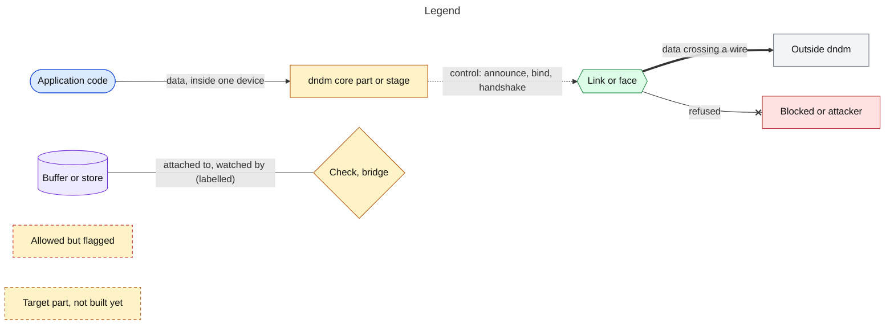

# dndm diagrams

Mermaid diagrams of how dndm works today ("as is") and how the owner-approved design will work ("target"). Each diagram shows one idea, and its caption says what to notice.

**Start here:**

1. [core 1](core.md#1-intent-meets-interest-as-is): intent meets interest
2. [message path 1](message-paths.md#1-inside-one-process-as-is): one Send inside a process
3. [message path 2](message-paths.md#2-to-another-node-as-is): the same Send to another node
4. [link flow 2](link-flows.md#2-announce-then-data-as-is): announce, then data
5. [core 5](core.md#5-what-one-data-frame-carries-as-is-vs-target): bytes per frame, today and target
6. [core 6](core.md#6-link-context-target): link context
7. [message path 5](message-paths.md#5-through-a-bridge-between-zones-target): through a bridge
8. [S1](robotics.md#s1-lidar-to-planner-across-three-devices): a real robot
9. [S9](robotics.md#s9-attack-paths): attack paths

| File | What it covers |
|---|---|
| [core.md](core.md) | The core idea: intents, interests, routes and endpoints as is, then the target link context with zones, bridges and stages |
| [link-flows.md](link-flows.md) | One link over time: bring-up, handshake per link profile, bind, rebind after a reset, close and reconnect (sequence diagrams) |
| [message-paths.md](message-paths.md) | How one message travels: inside a process, to another node, request and reply, through a bridge between zones, over broadcast |
| [robotics.md](robotics.md) | Robot scenarios from ideation's research-2 §9: lidar to planner across three devices, ELRS teleop, zones with a bridge, history replay, broadcast repair, CAN bus, build-time composition, attack paths |

## As is or target

- **As is**: the code at pin `c7b5b61` plus the uncommitted working tree after DND-R5. File and function names are given so you can check them.
- **Target (not built yet)**: the link-context design the owner adopted on 2026-11-08, worked out in [design/link-context-wire.md](../design/link-context-wire.md). Target diagrams say **Target** in the title and use dashed borders.

## Glossary

One word, one meaning, the same as in the design documents.

| Word | Meaning |
|---|---|
| **route** | a message type plus a path, e.g. `ManipulatorState` on `easyrobot.manipulator.raw` |
| **intent**, **interest** | "I can send this route", "I want this route" |
| **match** | today's pairing of an intent with an interest inside one process, done by a `Linker` |
| **face** | the transport a link runs over: UART, I²C, SPI, CAN, UDP, TCP, CRSF |
| **link** | a connection between two nodes over one face. It has one zone and one security profile |
| **session** | one life of a link, from HELLO to CLOSE. Its keys, counters and route ids die with it |
| **route id** | a small number that stands for a route on one link, set once by BIND |
| **zone** | a separate route table with its own keys. Every link belongs to exactly one zone |
| **bridge** | the only way between zones. It passes a route only if a **grant** names both zones and the route |
| **gateway** | joins dndm to something else in the same zone, without crossing zones: the NATS gateway, the CAN gateway |
| **stage** | one step a message passes on its way to a face: latest, buffered, fragment, Secure AEAD, end-to-end sign |
| **profile** | how a link is secured: OnBoard (none), zone key, static-DH, group key, or declared `Insecure(reason)` |

## Legend

The same shapes, arrows and colours are used in every flowchart. No caption changes what an arrow means.

Caption: the shape and colour say what a box is, and the arrow style says what moves along it.

| Element | Meaning |
|---|---|
| Rounded box, **blue** | application code (publisher, subscriber, service, controller) |
| Rectangle, **amber** | a dndm core part or a stage (router, Linker, dispatcher, table, Secure AEAD) |
| Diamond, amber | a check; bridges are drawn as diamonds because they check grants |
| Hexagon, **green** | a link or face |
| Cylinder, **purple** | a buffer, ring or history store |
| Rectangle, **grey** | outside dndm (RC radio, failsafe, NATS) |
| Rectangle, white | a field inside a frame |
| **Red** box | blocked, or an attacker |
| Amber box with a **red dashed** border | allowed but flagged (`Insecure(reason)`) |
| **Dashed border** on any box or frame | target part, not built yet |
| Solid arrow `-->` | data inside one device or process |
| Thick arrow `==>` | data crossing a wire between devices or nodes |
| Dotted arrow `-.->` | control only: announce, bind, handshake |
| Arrow ending in ✕ `--x` | refused |
| Plain line `---` with a label | attached to, watched by |
| Grey frame (subgraph) | a device, process or zone, as titled |

In sequence diagrams:

- solid arrows are data or requests, and dashed arrows are replies;
- an arrow ending in ✕ (`-x`) is lost in transit;
- `alt` blocks are failure branches;
- grey boxes only group one device's participants, and a red box marks an untrusted participant.

## How these were checked

Every block is rendered offline with `@mermaid-js/mermaid-cli` 12.2.0 (`mmdc`, bundling Mermaid 12.3.0), from the local npx cache, with headless Chrome from the local puppeteer cache. There is no network access. A deliberately broken block makes `mmdc` exit 1, so a clean exit means every block parsed and rendered. Results: [render-check.txt](render-check.txt).

The syntax is plain `flowchart` and `sequenceDiagram` with front-matter titles and `classDef` colours. Obsidian's bundled Mermaid 11.x and GitHub's renderer are **not tested**; layout may differ there.

[Overview](../index.md) · [Roadmap](../roadmap.md) · [Tickets](../tickets/index.md)
