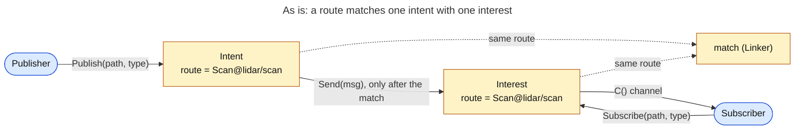
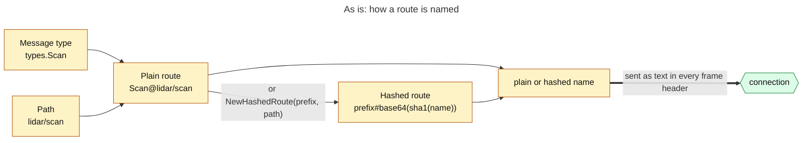
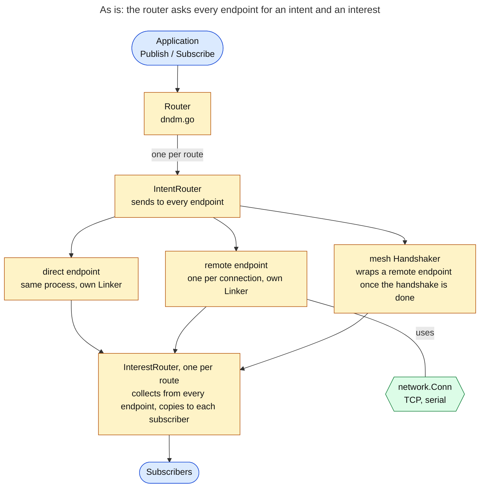
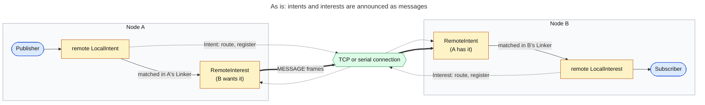
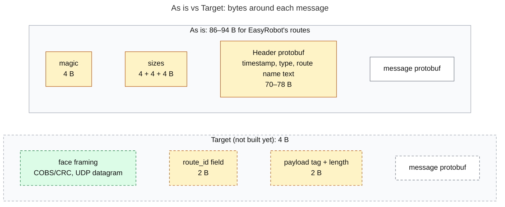
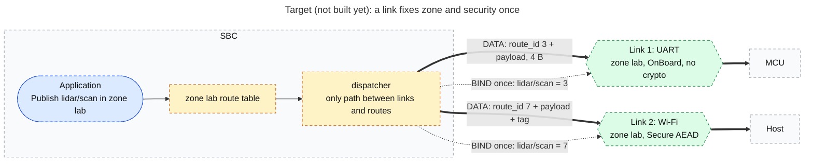
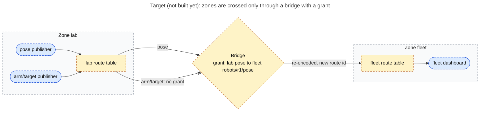
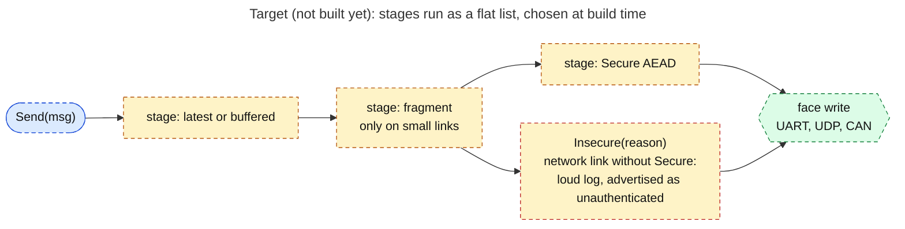

# Core idea

dndm moves typed protobuf messages by **name**. A publisher declares an **intent** ("I can produce `Scan` on `lidar/scan`"). A subscriber declares an **interest** ("I want `Scan` on `lidar/scan`"). When both exist for the same **route** (message type plus path), dndm **matches** them, and data flows. No intent or interest means no traffic. Words and arrows: [glossary and legend](README.md#glossary).

## 1. Intent meets interest (as is)

Caption: nothing is sent until an intent and an interest with the same route meet. Before that, `Send` returns `ErrNoInterest`.

## 2. Route names (as is)

Caption: today the route name, plain or hashed, travels as a string in the header of every message (`route.go`, `types/core` `Header.route`).

## 3. Inside one process (as is)

Caption: one `Publish` creates an intent in **every** endpoint, and one `Subscribe` an interest in every endpoint. Each endpoint's Linker matches its own intents and interests.

## 4. Announcing over a connection (as is)

Caption: each side mirrors the other's announcements as Remote objects, and each side's Linker matches a local object with a remote one. One route can't yet flow both ways on one connection (DND-020).

## 5. What one data frame carries (as is vs target)

Caption: today each EasyRobot message carries 86–94 B around it, mostly the route name. In the target it carries 4 B of protobuf (route id plus the payload's tag and length, for payloads under 128 B), because the name was bound once, when the link started. Secured links add a counter and an 8 B tag (about 15 B in total); on CAN the route id moves into the CAN identifier.

## 6. Link context (target)

Caption: the same route gets a different id on each link. Ids mean nothing outside their link, so a frame cannot name another link's routes or another zone.

## 7. Zones and crossing (target)

Caption: a zone is a separate route table, not a prefix on every name. The only way out is a bridge, and it passes only routes its grant names.

## 8. Build-time stages (target)

Caption: stages look like middleware in the API but run as a fixed list in one loop, so call depth stays constant. A network link uses either Secure or a declared `Insecure(reason)`, never neither. Unused stages are not linked into a small build.

[Diagrams index](README.md) · [Link flows](link-flows.md) · [Message paths](message-paths.md)
