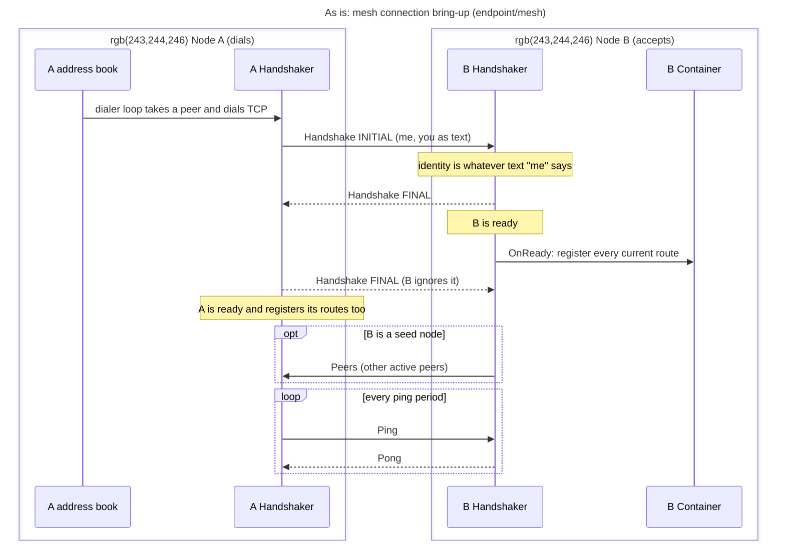
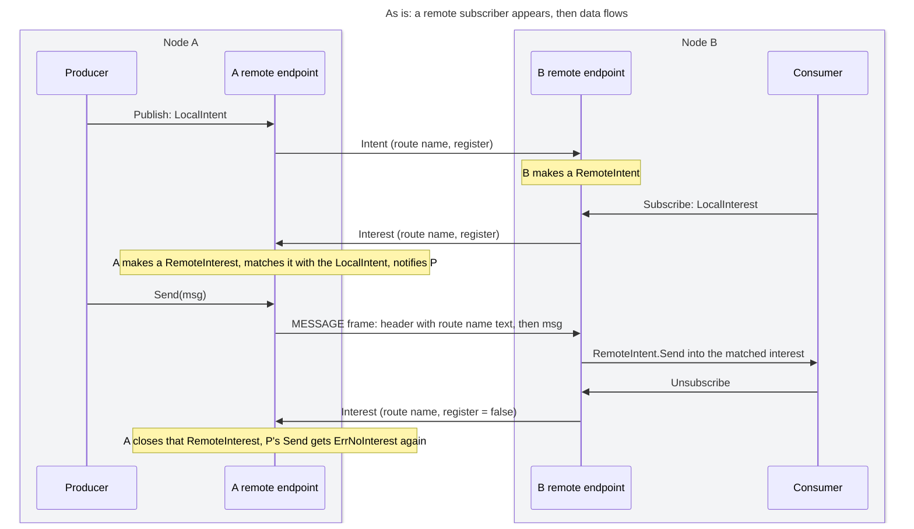
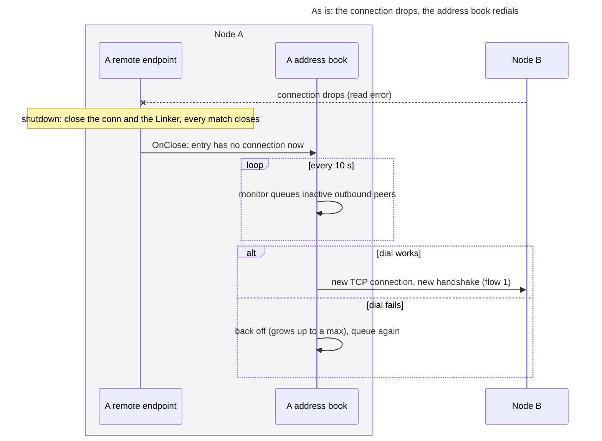
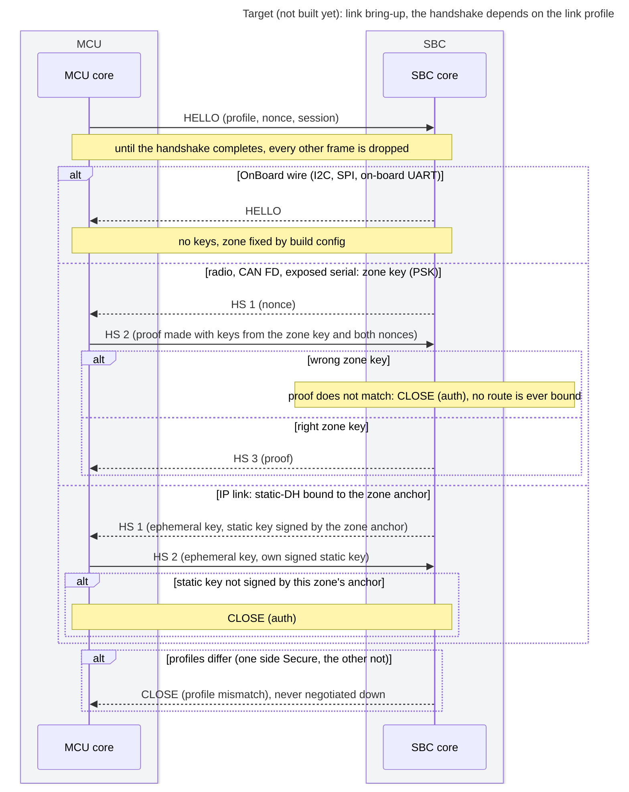
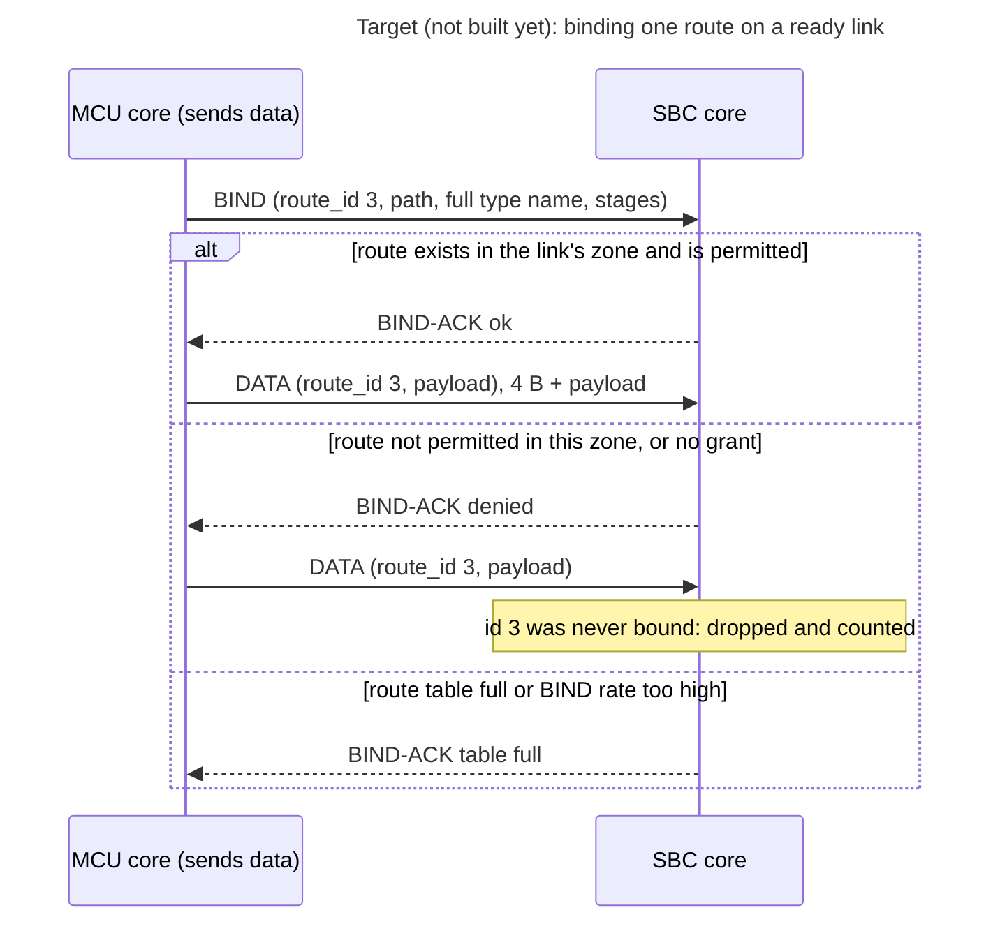
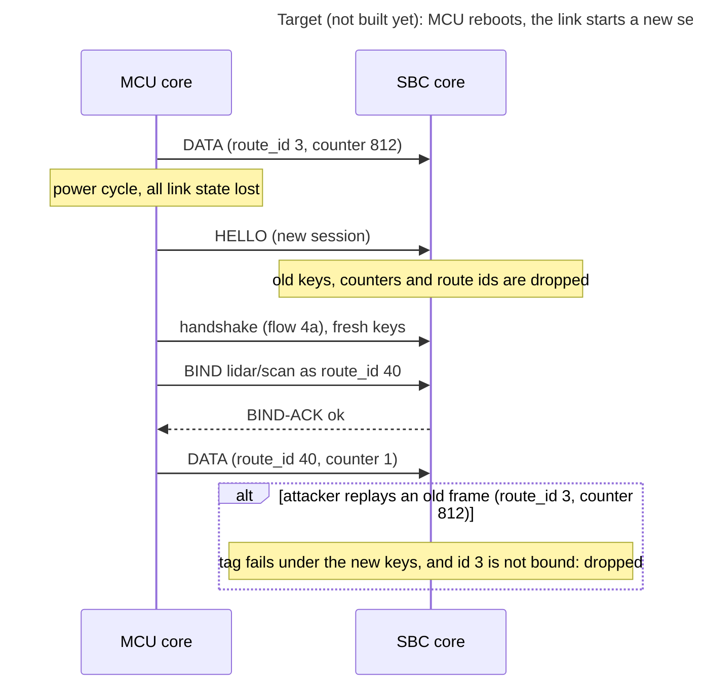
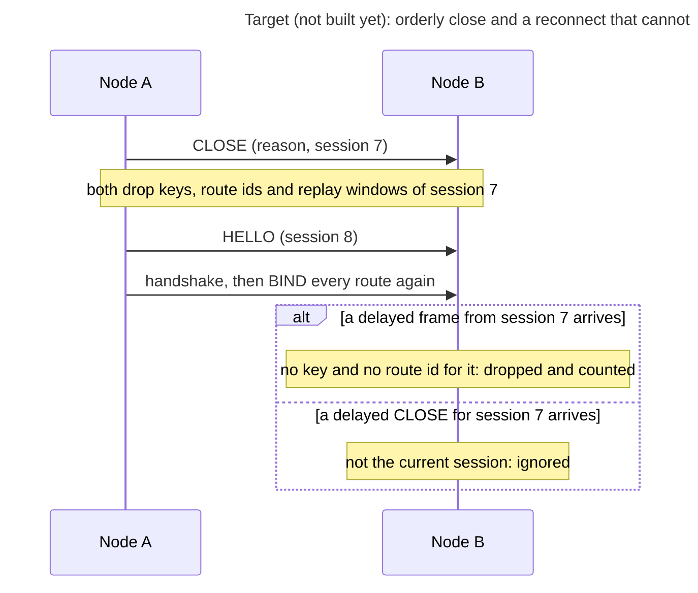

# Link flows

One link over time: how it starts, how routes get onto it, how data moves, and how it ends. In these sequence diagrams:

- solid arrows are data or requests;
- dashed arrows are replies;
- an arrow ending in ✕ is lost in transit;
- `alt` boxes are the failure branches;
- grey boxes only group the participants of one device.

Legend and glossary: [README](README.md#legend).

## 1. Bring-up today (as is)

Caption: the handshake swaps self-declared names and nothing else, with no key, zone or permission check. Routes are registered only after it finishes (DND-004). The **address book** is each node's list of known peers and their connections. A **seed node** is one that tells newcomers about other peers.

## 2. Announce, then data (as is)

Caption: every MESSAGE frame repeats the full route name in its header, and nothing checks whether A may publish or B may subscribe.

## 3. Losing the connection and redialling (as is)

Caption: a reconnect is a brand-new connection that registers every route again. What goes wrong with simultaneous connections, and how generations fix it, is in [design/close-reconnect.md](../design/close-reconnect.md).

## 4a. Handshake per link profile (target)

Caption: a wrong zone key is caught **at the handshake**, because the proof fails, before any route is bound. The per-frame tag is a second line of defence. Only broadcast links, which have no handshake, catch a wrong zone key at data time, by tag failures.

## 4b. Bind outcomes (target)

Caption: each route name is sent once, in BIND, and data frames then carry only the route id. The receiver drops data for an id that was never bound.

## 5. Rebind after a reset (target)

Caption: fresh keys on every session make it safe to restart counters, and new route ids continue after the old ones, so a replayed or late frame from before the reset matches nothing.

## 6. Close and reconnect (target)

Caption: a **session** is one life of a link, from HELLO to CLOSE. Ending it drops all of its state, so stale frames and a stale CLOSE have nothing to act on. Address-book generations are in [design/close-reconnect.md](../design/close-reconnect.md).

[Diagrams index](README.md) · [Core](core.md) · [Message paths](message-paths.md)
