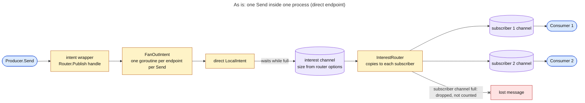
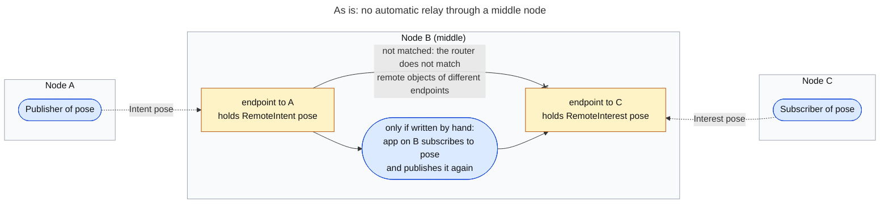
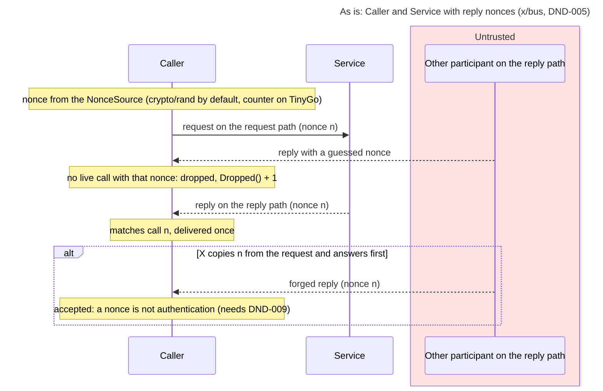
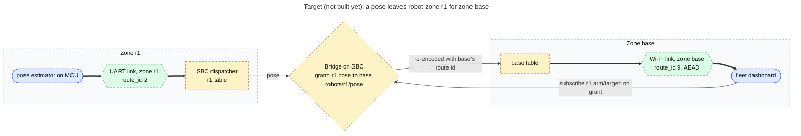
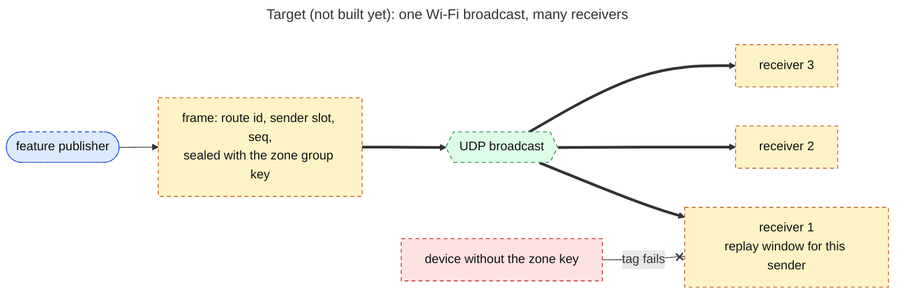

# Message paths

How one message travels from a publisher to its subscribers. The first four diagrams show code that exists today; the last two show the target design. Legend and glossary: [README](README.md#legend).

## 1. Inside one process (as is)

Caption: the sender waits while the interest channel is full, but a full subscriber channel silently loses the message (making that visible is DND-006/007). All subscribers share the very same message object, which is why it must not change after Send (DND-002).

## 2. To another node (as is)

```mermaid
---
title: "As is: one Send to a subscriber on another node (TCP)"
---
flowchart LR
    subgraph A["Node A"]
        prod(["Producer.Send"]):::app --> rli["remote LocalIntent"]:::core
        rli --> rq[("RemoteInterest channel")]:::store
        rq --> fwd["forwarder goroutine<br/>the only reader (DND-003)"]:::core
        fwd --> enc["encode frame<br/>header + route name + msg"]:::core
    end
    enc ==> tcp{{"TCP stream"}}:::link
    subgraph B["Node B"]
        dec["read and decode frame<br/>size capped (DND-001)"]:::core --> hm["handleMsg<br/>find RemoteIntent by route name"]:::core
        hm --> bq[("local interest channel")]:::store --> bsr["InterestRouter"]:::core --> cons(["Consumer"]):::app
    end
    tcp ==> dec

    classDef app fill:#dbeafe,stroke:#1d4ed8,color:#111
    classDef core fill:#fef3c7,stroke:#b45309,color:#111
    classDef store fill:#ede9fe,stroke:#6d28d9,color:#111
    classDef link fill:#dcfce7,stroke:#15803d,color:#111
    classDef group fill:#f9fafb,stroke:#9ca3af,color:#111
    class A,B group
```

Caption: the message is encoded once per remote peer, and the receiving side finds its route by the name text in the header.

## 3. Through a middle node (as is)

Caption: today a message crosses only one connection. To go further, an app on the middle node must subscribe and publish again (`container.go` refuses to re-announce remote intents and interests; `Router.addInterest` skips remote interests).

## 4. Request and reply (as is, x/bus)

Caption: nonces keep replies with the right call, even when several Callers share one reply path. They do not prove who answered.

## 5. Through a bridge between zones (target)

Caption: the message keeps its payload but gets a new route id and a new zone on the far side of the bridge. Without a grant, nothing crosses.

## 6. Broadcast to many receivers (target)

Caption: one transmission reaches every receiver. A group key keeps outsiders out, but any zone member could pose as another member unless the route is end-to-end signed. Repairing a missed frame is [S6](robotics.md#s6-wi-fi-broadcast-with-repair).

[Diagrams index](README.md) · [Core](core.md) · [Link flows](link-flows.md) · [Robotics](robotics.md)
