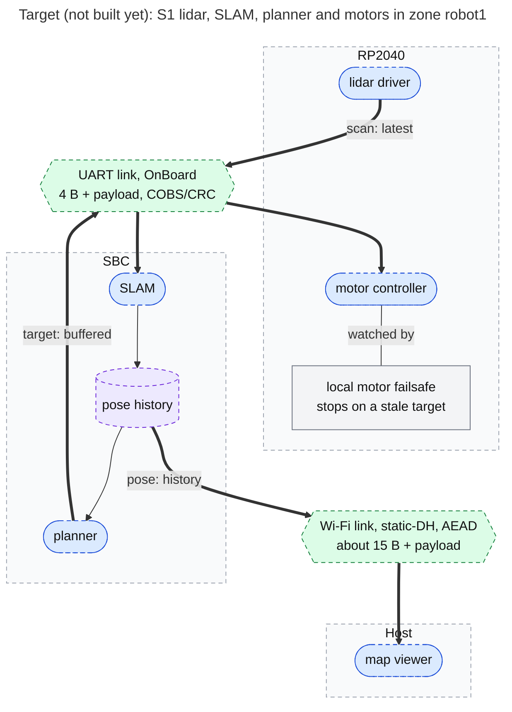
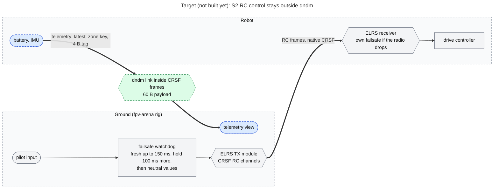
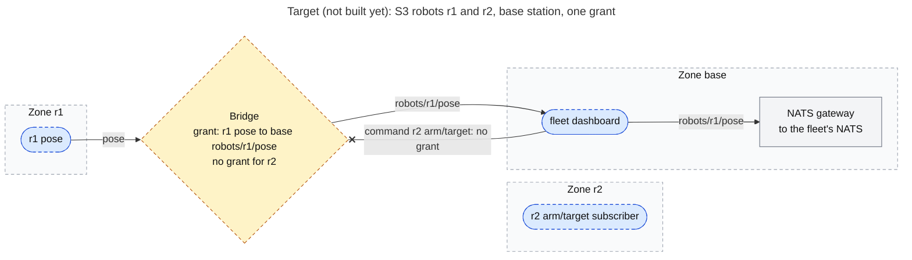
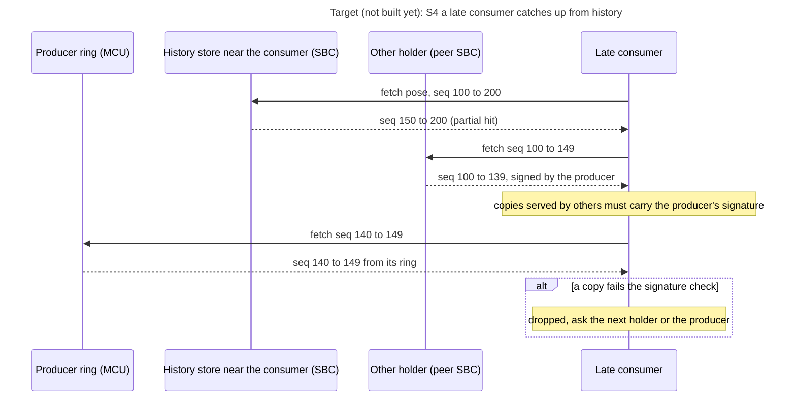
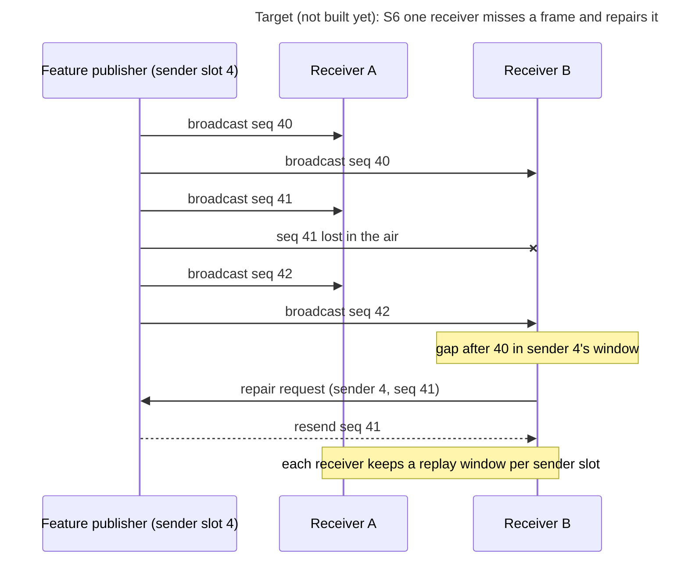
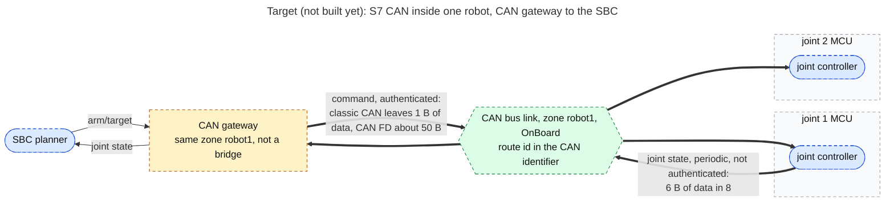
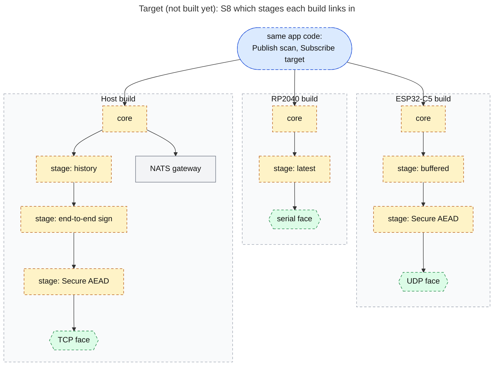
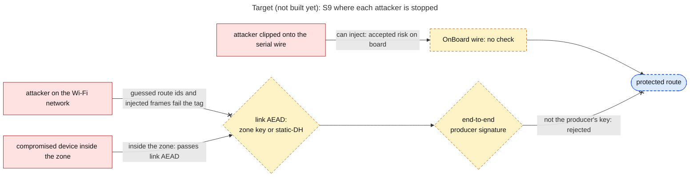

# Robotics scenarios

Scenarios S1–S9 from [research-2](../research/ideation/2026-11-08-ndn-delivery-auth-2.md) §9. All of them are **target designs (not built yet)**: today's dndm has no zones, link profiles, history or broadcast. Frame sizes follow the [link-context wire design](../design/link-context-wire.md): a data frame is 4 B plus the payload, and a secured one about 15 B. The rest are estimates from research-2 §6. Legend and glossary: [README](README.md#legend).

## S1. Lidar to planner across three devices

Caption: one zone spans all three devices, and each route picks its own delivery: latest for scans, history for poses, buffered for targets. The motor failsafe is local to the MCU and does not depend on dndm.

## S2. Teleop over ELRS with a failsafe

Caption: steering and throttle never go through dndm, so if dndm telemetry stops, only the view goes stale and nothing moves. The watchdog numbers are fpv-arena's settings (`drive-stale-ms` 150, `drive-hold-ms` 100, ADR 0022), and that watchdog runs on the rig, before the TX module, not on the robot.

## S3. Three zones with a bridge

Caption: every crossing goes through the bridge, and each needs its own grant. The base station can watch r1's pose, but its command for r2's arm stops at the bridge because no grant names it.

## S4. Sensor history replay

Caption: history can be served by anyone who holds a copy. The consumer trusts the producer's signature, not the holder.

## S5. Link bring-up

Drawn once, in [link-flows.md](link-flows.md):

- [4a](link-flows.md#4a-handshake-per-link-profile-target): the handshake per link profile, including a wrong zone key and a profile mismatch;
- [4b](link-flows.md#4b-bind-outcomes-target): bind outcomes (ok, denied, table full) and then data.

## S6. Wi-Fi broadcast with repair

Caption: only receivers that miss a frame ask for it, and only on routes with a buffer. Replay windows are kept per sender, so a resent frame is accepted once.

## S7. CAN actuator bus

Caption: the route id rides in the CAN identifier, so a frame spends only 2 B on protobuf. An authenticated command also needs a counter and a 3 B MAC, which leaves 1 B of data in classic CAN's 8 bytes. That stays true for every frame, because only the counter's low 7 bits are sent. That is why authenticated commands need CAN FD in practice; the owner's rule applies once a target is chosen. Sizes measured with code generated from the draft schema.

## S8. Same app, three builds

Caption: the app code does not change; the build picks the stages. Stages a build does not use are not linked in. Whether that holds for TinyGo or C++ binaries is still to be measured (DND-015).

## S9. Attack paths

Caption: each protection stops a different attacker.

- Link AEAD stops outsiders.
- End-to-end signatures stop insiders who forge a producer.
- Nothing stops a device physically on an on-board wire. That is why such wires must be declared `OnBoard()`.

Full table: research-2 §8.

[Diagrams index](README.md) · [Core](core.md) · [Link flows](link-flows.md) · [Message paths](message-paths.md)
